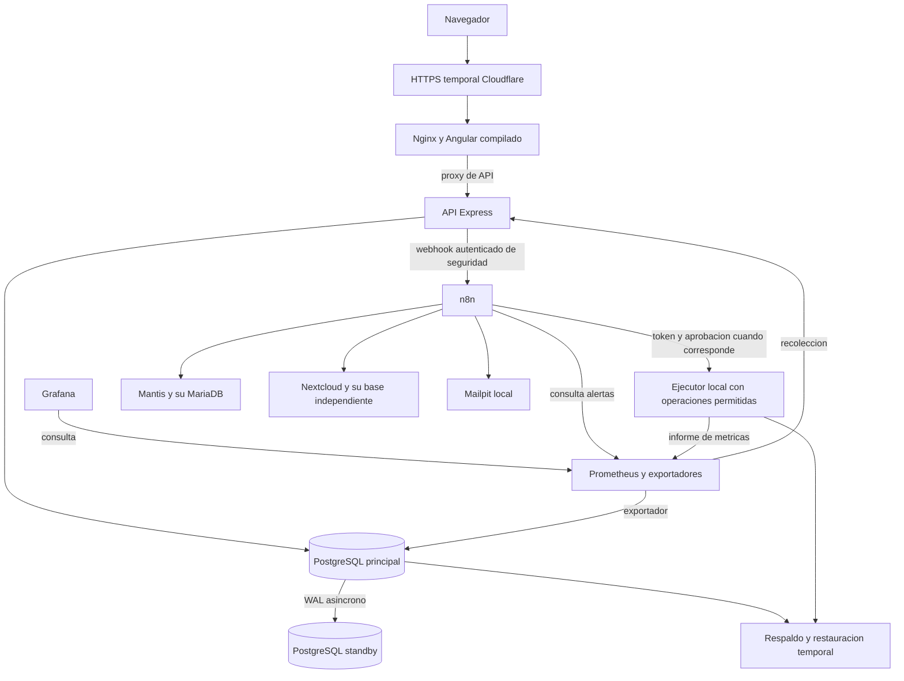

# Arquitectura final de Convoca para HIA

El diagrama inicial permanece en A1 del informe. Este esquema describe los componentes incorporados durante el trabajo.

- La publicación expone la aplicación por Nginx; no requiere hacer pública la base ni las herramientas administrativas.
- La API usa el principal, no la réplica. No hay balanceo de lecturas ni failover automático.
- Prometheus recopila y Grafana visualiza; ninguna de esas herramientas modifica las inscripciones.
- Mantis y Nextcloud tienen persistencia propia. Su motor auxiliar no cambia PostgreSQL de Convoca.
- El runner restringe operaciones; n8n no recibe el socket Docker ni autorización para ejecutar cualquier comando.
- El recorrido de desarrollo permite Angular con `npm start`; el de publicación usa su imagen Nginx. Son alternativas de arranque, no dos frontends obligatorios simultáneos.
