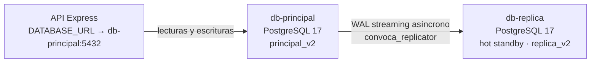

# Actividad 6 — Réplica PostgreSQL y recuperación

## Diseño

El laboratorio usa dos contenedores PostgreSQL 17 con la misma imagen fijada por digest. `db-principal` conserva el volumen `principal_v2` y es el único destino de lectura/escritura de la API. `db-replica` se inicializa desde una copia física del principal (`pg_basebackup -R`), usa el volumen separado `replica_v2` y opera como standby en caliente de replicación física asíncrona. El usuario `convoca_replicator` solo tiene `LOGIN` y `REPLICATION`; su contraseña vive en `infra/hia/.env`, que Git ignora.



La réplica no recibe escrituras mientras `pg_is_in_recovery()` devuelve `true`. La API no reparte lecturas ni promueve nodos: si el principal se detiene, la aplicación pierde la conexión hasta recuperar el principal o ejecutar una promoción manual coordinada. No hay failover automático.

## Preparar y arrancar

1. Completar la actividad 4: Docker Desktop activo, `.env` local preparado, laboratorio migrado y perfil piloto validado.
2. En `infra/hia/.env`, definir `REPLICATION_PASSWORD` con una clave aleatoria hexadecimal (sin `:` ni `\`, para que sea compatible con `.pgpass`) y, si el puerto está ocupado, cambiar `LAB_REPLICA_DB_PORT` (por defecto `5436`). No subir ese archivo.
3. Iniciar el perfil optativo de réplica:

```powershell
npm run lab:replica-up
```

El perfil crea o actualiza idempotentemente el rol, crea `replica_v2` si todavía no existe e inicia la réplica. La réplica solo se inicia con el perfil `replica`; `npm run lab:up` de A4 mantiene el comportamiento de principal + pgAdmin.

La API local de `infra/compose.yaml` sigue conectándose al principal. Dentro de Docker usa `db-principal:5432`; desde Windows se puede inspeccionar cada nodo por `localhost:5435` y `localhost:5436`.

## Identidad, estado y retraso

Consultar cada nodo de forma directa; no usar un alias que oculte qué servidor respondió:

```powershell
docker compose --env-file infra/hia/.env -f infra/hia/docker-compose.yml --profile replica exec -T db-principal psql -X -U convoca_lab -d postgres -c "SELECT inet_server_addr() AS nodo, pg_is_in_recovery() AS es_standby, current_setting('server_version') AS version;"
docker compose --env-file infra/hia/.env -f infra/hia/docker-compose.yml --profile replica exec -T db-replica psql -X -U convoca_lab -d postgres -c "SELECT inet_server_addr() AS nodo, pg_is_in_recovery() AS es_standby, current_setting('server_version') AS version;"
```

El principal debe devolver `es_standby = false`; la réplica, `true`. El principal muestra la conexión y sus LSN en `pg_stat_replication`:

```sql
SELECT application_name, state, sync_state, sent_lsn, write_lsn, flush_lsn,
       replay_lsn, write_lag, flush_lag, replay_lag
FROM pg_stat_replication;
```

Para medir bytes todavía no reproducidos:

```sql
SELECT pg_size_pretty(pg_wal_lsn_diff(pg_current_wal_lsn(), replay_lsn)) AS bytes_pendientes
FROM pg_stat_replication
WHERE application_name = 'convoca-replica';
```

En la réplica, `pg_last_wal_replay_lsn()` y `pg_last_xact_replay_timestamp()` permiten confirmar directamente el último WAL reproducido. La conexión es asíncrona: medir y documentar el retraso observado; no afirmar consistencia síncrona ni cero pérdida ante una promoción.

## Prueba controlada de propagación y recuperación

Crear un registro de prueba con identificador único en la base piloto del principal y leerlo directamente en `db-replica`. Registrar ambos resultados y el LSN antes/después. Usar una tabla temporal de evidencia y retirarla al finalizar:

```sql
CREATE TABLE IF NOT EXISTS public.actividad6_probe (
  id text PRIMARY KEY,
  creado_en timestamptz NOT NULL DEFAULT now()
);
INSERT INTO public.actividad6_probe (id) VALUES ('ID-UNICO-DE-LA-PRUEBA');
```

Esperar hasta que el registro sea visible en la réplica antes de continuar. Verificar `pg_stat_replication` antes de detenerla. Luego simular el fallo de la réplica:

```powershell
docker compose --env-file infra/hia/.env -f infra/hia/docker-compose.yml --profile replica stop db-replica
```

La API debe continuar conectada al principal; `pg_stat_replication` queda sin standby mientras este está detenido. Insertar un segundo registro de prueba en el principal y volver a iniciar la réplica:

```powershell
docker compose --env-file infra/hia/.env -f infra/hia/docker-compose.yml --profile replica up -d --wait db-replica
```

Comprobar que vuelve a `pg_stat_replication`, que reproduce el nuevo LSN y que ambos registros se leen en la réplica. Para completar la evidencia del efecto sobre la aplicación, comprobar `/api/health` antes y después de detener únicamente la réplica.

Limpiar únicamente los registros creados por la prueba, en el principal, y esperar su reproducción antes de terminar:

```sql
DELETE FROM public.actividad6_probe WHERE id IN ('ID-UNICO-DE-LA-PRUEBA', 'ID-UNICO-SEGUNDO');
DROP TABLE public.actividad6_probe;
```

## Recuperación manual y límites

- Un reinicio normal del standby conserva `replica_v2`; al reconectar, reproduce el WAL pendiente mientras siga disponible en el principal.
- Si el standby perdió WAL necesario o su volumen está dañado, no borrar volúmenes a ciegas. Tomar respaldo/verificar el estado, reemplazar solo el volumen de réplica acordado y volver a ejecutar `pg_basebackup` desde el principal.
- Si falla el principal, la réplica permanece de solo lectura. El servicio API, configurado contra `db-principal`, no cambia de nodo automáticamente.
- Una promoción requiere decisión manual, detener/escalar el principal para evitar split-brain, ejecutar `pg_ctl promote` en el standby y cambiar explícitamente la conexión de la API. La pérdida posible depende del WAL todavía no reproducido.
- Para volver a un principal recuperado, resincronizarlo desde el nuevo primario antes de permitir escrituras. No arrancar una copia antigua como segundo primario.

## Evidencias que registrar

Guardar la versión y rol de cada nodo, consulta de `pg_stat_replication`, LSN/lag medido, identificador del registro visto en ambos nodos, estado de la API y del principal mientras la réplica estuvo detenida, y estado/datos luego de recuperar y resincronizarla. Enlazar capturas y salidas del piloto en el apartado “Actividad 6” del informe del grupo.
